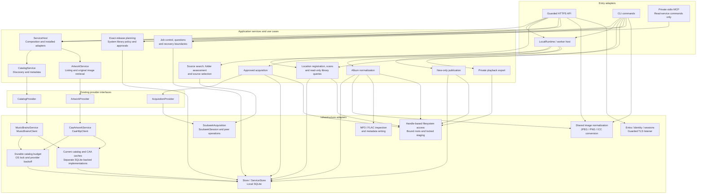
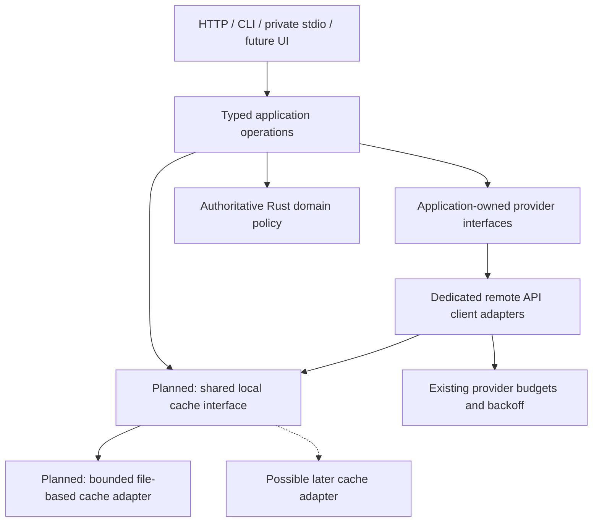

# Backend services and domains

This document maps the current Rust backend and the required design direction.
It describes logical services inside the application, not separate network
servers. The browser is one client. It must not define the service boundaries.

**Status:** current worktree, including local image compatibility changes.
Dashed arrows and nodes marked **Planned** show requirements, not working features.
The complete V1 application is not delivered.

Artwork size, accepted audio formats, format priorities and output templates
belong to one administrator-controlled system policy for the shared library.
`settings_versions` stores global immutable versions, not per-user preferences.
Plans retain their selected settings version. The current production identity
boundary permits one configured tenant/object pair; multi-user administrator
roles are not yet implemented. Any later multi-user access must keep system
setting writes administrator-only.

## Current service map

Arrows show calls or use of a contract. This is a logical map, not an exhaustive
Rust import graph.

`ServiceHost` currently composes catalog, artwork and database access.
Acquisition has a separate provider contract and worker wiring. It is not a
field on `ServiceHost`. Source search is still tied to worker configuration.
Some API handlers call `Store` and concrete services directly.
These are current design limits, not the desired final separation.

Image preparation uses the shared normalizer through guarded store operations.
It is distinct from `ArtworkService.fetch`: retrieving an original image does
not normalize it, grant rights or approve a preview.

## Domain map

These are logical areas, not claims that each area is an isolated bounded context.
Pure domain rules are in `crates/domus/src/domain`. Durable rules also remain in
`infrastructure/store`; the code does not yet enforce a fully independent
application layer.

| Domain area                      | Owned concepts and rules                                                                      | Main source                                                                 |
| -------------------------------- | --------------------------------------------------------------------------------------------- | --------------------------------------------------------------------------- |
| Catalog and edition identity     | Artists, releases, release groups, ordered media/tracks, credits and release filters          | `domain/catalog.rs`, `domain/identifiers.rs`                                |
| Output planning and settings     | Immutable settings, edition selections, planned tracks, portable templates and output formats | `domain/planning.rs`, `domain/templates.rs`                                 |
| Source assessment                | Complete folder mapping, unexpected files, advertised quality and unknown metadata            | `domain/sources.rs`                                                         |
| Jobs and decisions               | Job states, artwork issues, bounded questions and offered choices                             | `domain/jobs.rs`, `domain/questions.rs`                                     |
| Media metadata                   | Exact-release tags and identifiers; tag text stays separate from filename replacements        | `domain/media.rs`                                                           |
| Library paths and paging         | Library-relative identifiers and bounded page requests                                        | `domain/paths.rs`                                                           |
| Durable acquisition and recovery | Claims, leases, source approval, transfer intent, sealed inputs and receipts                  | `store/source_candidates.rs`, `store/transfers.rs`, application acquisition |
| Artwork evidence and approval    | Original-image provenance, retained JPEG bytes, exact hash approval and recovery questions    | `store/caa.rs`, `store/artwork.rs`, `store/artwork_questions.rs`            |
| Publication                      | New-only destination intent, exact output receipts, backup state and restart verification     | Application publication, `store/publication.rs`                             |
| Identity and access              | Entra tenant/object authorization, browser login state and durable sessions                   | `infrastructure/entra`, `infrastructure/identity`, `store/sessions.rs`      |

## Main workflows and boundaries

Each arrow includes state and version checks. It is not permission to skip a
step. Discovery and original artwork retrieval can run independently of a job.
Preparation and media effects require their applicable plan and approval checks.
Library browsing remains read-only.

Cross-cutting infrastructure includes bounded database work, durable events and
session-checked event replay, TLS connection limits, native root identity checks,
no-follow directory handles and the staging OS lock. SQLite stays on local disk.
Filesystem and network I/O must remain outside database transactions.

## Required direction

Every remote API integration must have a dedicated client type behind an
interface. In Rust, use a client struct and an application-owned trait at a real
I/O boundary. Reuse existing provider traits instead of adding redundant wrappers.
Keep protocol, parsing and transport limits inside client adapters.
Keep workflow policy outside clients and UI components.

The shared cache is planned. It must replace duplicated storage mechanics, not
provider-specific freshness or request budgets. Start with a file-based adapter
behind a small replaceable contract. Album covers, artist images and provider
responses can use it. Eviction must not remove approved evidence or recovery
records. Current caches have not been migrated.

The planned image retrieval service also owns scaled variants through the shared
normalizer. The user selects a 200 x 200, 400 x 400 (recommended) or 800 x 800
bounding box. Preserve aspect ratio and never enlarge. Cache the original and
each content-bound variant through the shared cache interface. Remote clients
fetch bytes; they do not each implement resizing. New plans freeze the chosen
target, and approval remains bound to the exact JPEG used for tags and folder
artwork. New settings support 200/400/800-pixel targets; legacy plans retain the
1200-pixel maximum. Target selection currently runs through plan-bound Store
preparation. Shared file-cache variants and reusable service orchestration remain
open.

## Known gaps for design review

- Artist-photo discovery has no installed provider. CAA supplies release artwork,
  not artist photos. The image normalizer itself is reusable.
- System settings now separate accepted combinations from one preferred choice.
  New plans enforce that accepted set. Current processing supports MP3 320 CBR
  and FLAC; other bitrates, VBR and M4A acceptance are not implemented.
- The System route uses the normal application shell. Guarded root registration
  and indexing reuse application use cases, native root bindings and Store
  checks. Existing roots cannot be edited, deleted or rebound through the UI.
- Search and acquisition are not general concurrent Soulseek services. Persistent
  concurrent operations need one reader per connection and bounded typed routing.
- Settings, approvals, indexing and recovery use cases still depend on concrete
  `Store` operations. Acquisition interfaces also accept concrete store/staging
  types. Do not present these as fully infrastructure-independent interfaces.
- The production service host installs known built-ins. Provider replacement is
  supported by existing service traits, but adding a provider still needs explicit
  host registration and capability validation.
- UI-independent contracts, shared caching and provider scheduling need further
  implementation. A diagram node does not establish their acceptance.

## Source guide

Source paths below are relative to `crates/domus/src`.

| Concern                              | Source                                                                            |
| ------------------------------------ | --------------------------------------------------------------------------------- |
| Service contracts and typed requests | `application/services.rs`, `application/services/acquisition.rs`                  |
| Composition and installed clients    | `infrastructure/services.rs`                                                      |
| Catalog planning                     | `application/catalog.rs`                                                          |
| Indexing                             | `application.rs`                                                                  |
| Media workflows                      | `application/acquisition.rs`, `normalization.rs`, `publication.rs`, `playback.rs` |
| Remote protocols                     | `infrastructure/catalog`, `caa`, `soulseek`                                       |
| API, worker and stdio entry points   | `infrastructure/api.rs`, `worker.rs`, `local_runtime.rs`, `mcp`                   |
| Images and audio processing          | `infrastructure/artwork`, `media.rs`, `mp3`, `flac`                               |
| Durable state and migrations         | `infrastructure/store`, `crates/domus/migrations` from the repository root        |

Keep this map current when service boundaries change. Record implemented
behavior separately from requirements in [PRODUCT.md](../PRODUCT.md).
