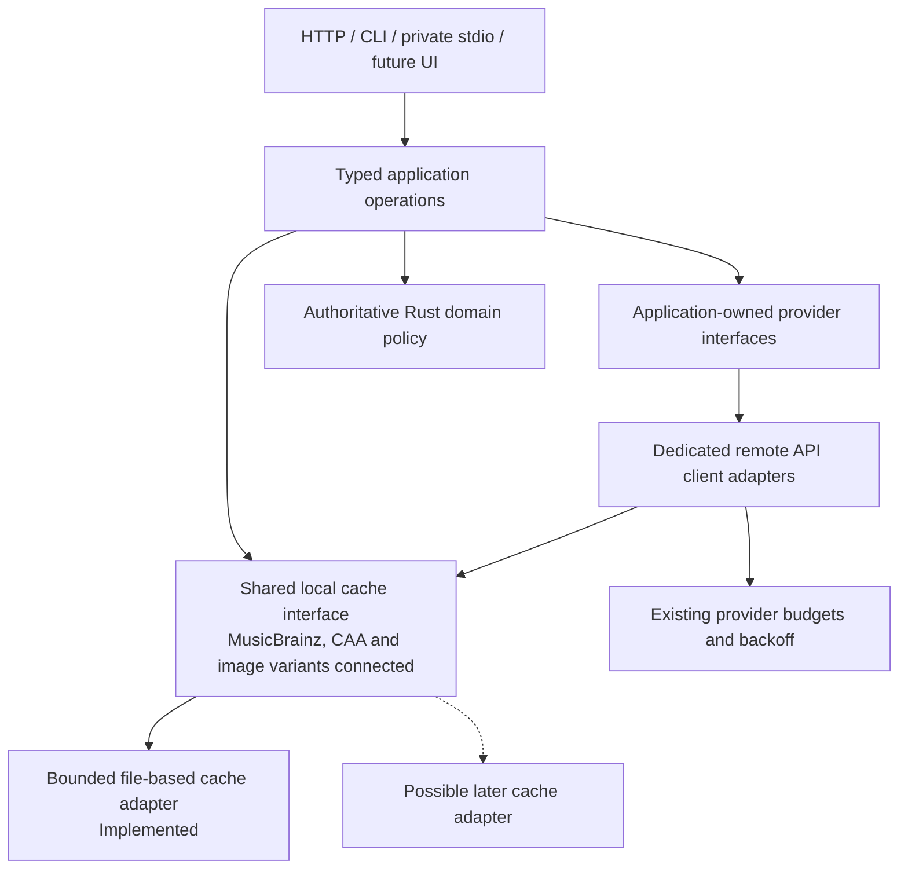

# Backend services and domains

This document maps the current Rust backend and the required design direction.
It describes logical services inside the application, not separate network
servers. The browser is one client. It must not define the service boundaries.

**Status:** current worktree, including local image compatibility changes.
Dashed arrows and nodes marked **Planned** show requirements, not working features.
The complete V1 application is not delivered.

Artwork size, accepted audio formats, format priorities and output templates
belong to one administrator-controlled system policy for the shared library.
`settings_versions` stores global immutable versions, not per-user preferences.
Plans retain their selected settings version. The current production identity
boundary permits one configured tenant/object pair; multi-user administrator
roles are not yet implemented. Any later multi-user access must keep system
setting writes administrator-only.

## Current service map

Arrows show calls or use of a contract. This is a logical map, not an exhaustive
Rust import graph.

```mermaid
flowchart TB
    subgraph Entry["Entry adapters"]
        API["Guarded HTTPS API"]
        CLI["CLI commands"]
        MCP["Private stdio MCP<br/>Read-service commands only"]
        Runtime["LocalRuntime / worker host"]
    end

    subgraph Application["Application services and use cases"]
        Host["ServiceHost<br/>Composition and installed adapters"]
        Catalog["CatalogService<br/>Discovery and metadata"]
        Art["ArtworkService<br/>Listing and original image retrieval"]
        Retrieve["ImageService<br/>Original retrieval and variant processing"]
        Index["Location registration, scans<br/>and read-only library queries"]
        Plan["Exact-release planning<br/>System library policy and approvals"]
        Source["Source search, folder assessment<br/>and source selection"]
        Acquire["Approved acquisition"]
        Normalize["Album normalization"]
        Publish["New-only publication"]
        Playback["Private playback export"]
        Jobs["Job control, questions<br/>and recovery boundaries"]
    end

    subgraph Ports["Existing provider interfaces"]
        CP["CatalogProvider"]
        AP["ArtworkProvider"]
        XP["AcquisitionProvider"]
    end

    subgraph Adapters["Infrastructure adapters"]
        MB["MusicBrainzService<br/>MusicBrainzClient"]
        CAA["CaaArtworkService<br/>CaaHttpClient"]
        SS["SoulseekAcquisition<br/>SoulseekSession and peer operations"]
        Images["Shared image normalization<br/>JPEG / PNG / ICC conversion"]
        Media["MP3 / FLAC inspection<br/>and metadata writing"]
        FS["Handle-based filesystem access<br/>Bound roots and locked staging"]
        Store["Store / ServiceStore<br/>Local SQLite"]
        Gate["Durable catalog budget<br/>OS lock and provider backoff"]
        Caches["MusicBrainz and legacy CAA caches<br/>SQLite-backed"]
        FileCache["Configured MusicBrainz, CAA and JPEG variants<br/>Shared file-cache port"]
        Auth["Entra / identity / sessions<br/>Guarded TLS listener"]
    end

    API --> Host
    CLI --> Host
    MCP --> Host
    API --> Runtime
    CLI --> Runtime
    Runtime --> Source
    Runtime --> Acquire
    Runtime --> Normalize
    Runtime --> Publish
    CLI --> Playback
    API --> Index
    CLI --> Index
    API --> Plan
    CLI --> Plan
    API --> Jobs
    CLI --> Jobs
    Host --> Catalog
    Host --> Art
    Catalog --> CP
    Art --> AP
    CP --> MB
    AP --> CAA
    Acquire --> XP
    XP --> SS
    Source --> SS
    Plan --> Store
    Jobs --> Store
    Index --> Store
    Index --> FS
    Acquire --> Store
    Acquire --> FS
    Normalize --> Store
    Normalize --> Images
    Normalize --> Media
    Normalize --> FS
    API --> Retrieve
    Host --> Retrieve
    Retrieve --> Art
    Retrieve --> Images
    CLI --> Images
    Publish --> Store
    Publish --> FS
    Playback --> FS
    MB --> Gate
    CAA --> Gate
    MB --> Caches
    CAA --> Caches
    CAA --> FileCache
    MB --> FileCache
    Images --> FileCache
    Gate --> Store
    Caches --> Store
    API --> Auth
```

`ServiceHost` currently composes catalog, artwork, image retrieval and database access.
Acquisition has a separate provider contract and worker wiring. It is not a
field on `ServiceHost`. Source search is still tied to worker configuration.
Some API handlers call `Store` and concrete services directly.
These are current design limits, not the desired final separation.

Image preparation uses the shared normalizer through guarded store operations.
It is distinct from `ArtworkService.fetch`: retrieving an original image does
not normalize it, grant rights or approve a preview.
The HTTPS download flow uses `ImageService` to coordinate that original fetch
with the application-owned `ImageProcessor` port. The native adapter bounds
blocking decoding/cache work. Persistence rechecks the current approved plan,
frozen target/profile and fresh exact original evidence before retaining the
returned JPEG. It performs no second encoding. Cache-only and local preparation
continue through the same normalizer and guarded persistence.

## Domain map

These are logical areas, not claims that each area is an isolated bounded context.
Pure domain rules are in `crates/domus/src/domain`. Durable rules also remain in
`infrastructure/store`; the code does not yet enforce a fully independent
application layer.

| Domain area                      | Owned concepts and rules                                                                      | Main source                                                                 |
| -------------------------------- | --------------------------------------------------------------------------------------------- | --------------------------------------------------------------------------- |
| Catalog and edition identity     | Artists, releases, release groups, ordered media/tracks, credits and release filters          | `domain/catalog.rs`, `domain/identifiers.rs`                                |
| Output planning and settings     | Immutable settings, edition selections, planned tracks, portable templates and output formats | `domain/planning.rs`, `domain/templates.rs`                                 |
| Source assessment                | Complete folder mapping, unexpected files, advertised quality and unknown metadata            | `domain/sources.rs`                                                         |
| Jobs and decisions               | Job states, artwork issues, bounded questions and offered choices                             | `domain/jobs.rs`, `domain/questions.rs`                                     |
| Media metadata                   | Exact-release tags and identifiers; tag text stays separate from filename replacements        | `domain/media.rs`                                                           |
| Library paths and paging         | Library-relative identifiers and bounded page requests                                        | `domain/paths.rs`                                                           |
| Durable acquisition and recovery | Claims, leases, source approval, transfer intent, sealed inputs and receipts                  | `store/source_candidates.rs`, `store/transfers.rs`, application acquisition |
| Artwork evidence and approval    | Original-image provenance, retained JPEG bytes, exact hash approval and recovery questions    | `store/caa.rs`, `store/artwork.rs`, `store/artwork_questions.rs`            |
| Publication                      | New-only destination intent, exact output receipts, backup state and restart verification     | Application publication, `store/publication.rs`                             |
| Identity and access              | Entra tenant/object authorization, browser login state and durable sessions                   | `infrastructure/entra`, `infrastructure/identity`, `store/sessions.rs`      |

## Main workflows and boundaries

Each arrow includes state and version checks. It is not permission to skip a
step. Discovery and original artwork retrieval can run independently of a job.
Preparation and media effects require their applicable plan and approval checks.
Library browsing remains read-only.

Cross-cutting infrastructure includes bounded database work, durable events and
session-checked event replay, TLS connection limits, native root identity checks,
no-follow directory handles and the staging OS lock. SQLite stays on local disk.
Filesystem and network I/O must remain outside database transactions.

## Required direction

Every remote API integration must have a dedicated client type behind an
interface. In Rust, use a client struct and an application-owned trait at a real
I/O boundary. Reuse existing provider traits instead of adding redundant wrappers.
Keep protocol, parsing and transport limits inside client adapters.
Keep workflow policy outside clients and UI components.

The shared cache contract and file adapter are implemented in
`application::services::cache` and `infrastructure::cache`. An explicit host
`cache` setting opens the adapter and passes the same port through `ServiceHost`
to catalog/CAA operations and plan-bound image preparation. Configured responses do
not use the legacy SQLite cache or fall back to it. Local source metadata reads
receive this same host-selected port. Provider-specific freshness, provenance checks and request budgets remain
unchanged. Album covers, future artist images and provider responses can use the
same port. Eviction cannot reach approved evidence or recovery records; they
remain in their existing durable stores.

Each file-cache operation holds its OS lock through reads, replacement and
eviction. Its guard explicitly unlocks before releasing the adapter mutex.
Closing the handle alone is not sufficient: a concurrent process launch can
inherit the same open file description until execution replaces the child.
The [Linux `flock` reference](https://man7.org/linux/man-pages/man2/flock.2.html)
describes this lock lifetime. A retained-descriptor regression checks both
exclusion during an operation and release after the guard exits.

Configured CAA responses have a bounded, versioned envelope with original bytes
and the complete source chain. Reads validate the chain, exact filename and
24-hour freshness before use. Provider-budget completion commits before file
storage, outside the SQLite transaction. A storage error cannot undo the consumed
permit or saved backoff. There is no automatic refetch after corruption or I/O
failure. A configured file cache does not import or delete legacy cache rows.
Hosts without this explicit setting retain legacy behavior.
MusicBrainz keys retain the full canonical request URL, including pagination and
query parameters. Reads check the original response against that exact query.
Exact-release planning still compares parsed content, original hash and fetch
time before freezing evidence. Source metadata uses a read-only, current-schema
autocommit connection for file-cache lookup, not a long-lived SQL snapshot.
The ordinary snapshot API retains its transaction behavior and rejects shared
file reads inside that transaction.

`CacheKey` hashes length-delimited provider, namespace and logical identifier
fields. Callers never select native entry paths. `FileCache::open` explicitly
reserves an existing owner-only local directory and binds its native identity
and ancestry to the application database. It rejects media/staging/state
overlaps and copied owner markers. Schema 21 expands the root-kind constraints
without changing existing bindings, IDs, timestamps or immutable triggers.
All file operations stay on no-follow directory handles.

Each complete cache operation holds an OS lock. Clones share a mutex, while
independent API/worker adapters can open the same bound root. A competing
operation receives an explicit busy error rather than racing another writer.
Startup holds the same lock before discarding an interrupted temporary write.
The marker handle stays open and is never replaced. The port is blocking I/O
and must not run on an async executor thread.
Each operation opens a separate lock handle rather than cloning an already
locked handle. This follows the [Rust `File::try_lock` contract](https://doc.rust-lang.org/std/fs/struct.File.html#method.try_lock).
Dropping that operation handle releases its lock. Untrusted OS users are
excluded by private permissions; an advisory lock alone is not a permission
boundary.

Entries have a fixed 96-byte header with key digest, payload SHA-256, storage
time, expiry and byte length. A lookup returns a hit, miss, expired or corrupt
result; storage and permission errors remain errors. A backward clock jump
expires an entry rather than extending its authority. No lookup serves stale
bytes. Payloads are bounded before allocation and checked against their digest.
Corrupt entries can be explicitly invalidated by logical key, including after
reopen. Unknown files are never adopted or removed.

Writes sync one private temporary file, then rename it over the entry under
the owner lock. A failed or interrupted pre-rename write leaves the old entry
unchanged. The next open/write removes only the validated `pending.cache` file.
Filesystem errors remain explicit. This is process-interruption recovery, not
verified power-loss acceptance.

Limits require 1 through 4,096 entries, items up to 32 MiB and total entry
storage up to 1 GiB. Total storage includes headers and temporary replacement
bytes, but not the small owner marker. It must have room for two maximum-size
encoded entries. Put evicts by earliest expiry, with stable tie breakers,
until entry and storage bounds permit an atomic write. A replacement can evict
another entry to keep temporary storage bounded. Explicit expiry eviction
inspects at most the configured entry bound and removes no more than its
requested limit. No cache operation deletes a job, plan, preview or receipt.

The image retrieval service creates scaled variants through the shared
normalizer. The user selects a 200 x 200, 400 x 400 (recommended) or 800 x 800
bounding box. Preserve aspect ratio and never enlarge. Cache the original and
each content-bound variant through the shared cache interface. Remote clients
fetch bytes; they do not each implement resizing. New plans freeze the chosen
target, and approval remains bound to the exact JPEG used for tags and folder
artwork. New settings support 200/400/800-pixel targets; legacy plans retain the
1200-pixel maximum. Target selection currently runs through plan-bound Store
preparation. Configured file-cache hosts now reuse strict JPEG variants keyed by
original digest, target, normalization profile and transparency background.
Cache hits pass the retained JPEG validator. CAA original freshness is checked
before preview preparation, independently of variant reuse. A different target
creates a different cache entry, not a replacement approval. Artist-image
installation remains open. Retrieval and processing ports are independently
replaceable; no provider client owns resize policy. The existing read-only MCP
original-fetch contract is unchanged.

The file-backed HTTPS bootstrap and guarded API share `ConfigurationService`.
This is the sole backend JSON access boundary. It owns parsing, normalization,
startup loading, active/saved inspection, redaction, revisions, hidden-field
merging, validation, and atomic persistence. Runtime startup still owns migrations,
cache activation, authentication setup, and listeners; passive service operations
cannot invoke those effects. Native persistence helpers stay private.

`GET /api/system/configuration` reads the service on a blocking
worker, without a Store transaction. It returns a redacted immutable active
snapshot and a passive, bounded no-follow read of saved JSON. Raw JSON digests
identify changed saved state; they do not prove validation or activation.
Secret-file paths and Entra identifiers are excluded from the browser DTO.
Inspection cannot open a new database/cache/staging root, validate TLS, contact
providers or change the active read-only policy. APIs without a service return an
explicit unavailable error.

The typed validation/save routes call the same service and authoritative startup
rules on blocking workers. Passive validation can read protected local files and
TLS material and query current-schema database records. No file or network I/O
runs inside a database transaction. The service enforces active and saved
read-only restrictions independently of the transport guard. Browser DTOs cannot
change the operator switch.

Saves hold the cooperating-writer OS lock through revision checks, secret merging,
validation, synced temporary output, native handle-relative replacement, and
result verification. Parent and target identities are checked. Pre-commit errors
preserve the old file; post-replacement errors identify uncertainty explicitly.
Successful saves retain only revision-bound validation evidence in memory.
Changed external bytes invalidate it. Backend JSON changes require explicit reload or restart.
Startup loading is still not a safe dry-run validator: the runtime can migrate
the database and bind the selected cache after service loading.

Typed section commands share this service and the same persistence implementation.
They carry complete updates for selected sections, not a replacement document.
The service rejects duplicate/unknown sections and stale whole-file revisions,
merges hidden references, and validates the full candidate before atomic save.
It reports per-section active/saved differences without disclosing hidden values.
Music output policy and root configuration delegate to their existing Store and
application operations through ConfigurationService. Their persistence semantics
remain separate from backend JSON.

The service owns one bounded reload channel and pending/active/failed state.
The API host consumes exact-revision requests. A candidate service keeps a new
immutable active snapshot while sharing the writer identity and lifecycle gate.
Host preparation runs beside the existing listener. Busy local effects reject
reload. A local-runtime permit prevents new effects during preparation.
After revision verification, the old generation drains and the new generation
uses the same guarded listener implementation. A retained bound socket permits
restoration on handover failure. Separate worker processes remain unchanged.
Passive service operations cannot enter this lifecycle path.

## Read-only sharing boundary

`domain/sharing.rs` owns access policy, file-type eligibility and finite resource
limits. `application/sharing.rs` exposes explicit library-folder inspection and
binding. `infrastructure/shares.rs` builds a bounded catalog through native
directory handles. An indexed filename alone never authorizes an upload.

The production worker optionally starts `soulseek/sharing.rs`. One account owner
holds the native account lock through sharing, acquisition, reconnect and drain.
The existing framed transport owns all socket reads. Separate bounded routes
keep browse requests off the acquisition offer queue, including requests on an
acquisition peer's existing control socket. Shared socket writes serialize whole
frames. A failed streamed frame retires the physical connection.
Acquisition can borrow an existing sharing control connection for the same
server-bound peer address. It does not send a second peer init. Duplicate peer
controls are rejected before init. A frame already in progress returns Busy
instead of blocking a new acquisition behind a large browse response. Active
acquisition controls keep their sharing handler alive and use a shorter browse
write budget.

Browse preparation uses paged catalog reads, bounded zlib output and a private
spool. Normal input frame and event limits stay unchanged. Raw upload sockets
remain separate from the framed reader. Uploads read the exact authorized handle
with checked offsets, bounded buffers and finite time limits.

Application publication takes the matching exclusive visibility guard before
new destination effects. Sharing retains a read guard over protected work.
Pending and failed destinations remain excluded. A complete destination receipt
can expose the primary while a backup remains pending. Future replacement and
recovery entry points must use the same guard. OS advisory locks do not prevent
arbitrary external in-place writes on Linux.

The Music Sharing configuration section owns only its worker subsection.
Acquisition and Sharing saves preserve sibling drafts and saved fields.
Inspection and validation stay passive. Explicit native binding and worker
restart remain separate operator actions.

## Known gaps for design review

- Artist-photo discovery has no installed provider. CAA supplies release artwork,
  not artist photos. The image normalizer itself is reusable.
- System settings now separate accepted combinations from one preferred choice.
  New plans enforce that accepted set. Current processing supports MP3 320 CBR
  and FLAC; other bitrates, VBR and M4A acceptance are not implemented.
- The System route uses the normal application shell. Guarded root registration
  and indexing reuse application use cases, native root bindings and Store
  checks. Existing roots cannot be edited, deleted or rebound through the UI.
- Standalone source searches are not a general concurrent search service.
  Configured sharing and acquisition have bounded routing through one account
  owner; this does not implement unrestricted concurrent client operations.
- Settings, approvals, indexing and recovery use cases still depend on concrete
  `Store` operations. Acquisition interfaces also accept concrete store/staging
  types. Do not present these as fully infrastructure-independent interfaces.
- The production service host installs known built-ins. Provider replacement is
  supported by existing service traits, but adding a provider still needs explicit
  host registration and capability validation.
- UI-independent contracts, shared caching and provider scheduling need further
  implementation. A diagram node does not establish their acceptance.

## Source guide

Source paths below are relative to `crates/domus/src`.

| Concern                              | Source                                                                            |
| ------------------------------------ | --------------------------------------------------------------------------------- |
| Service contracts and typed requests | `application/services.rs`, `application/services/acquisition.rs`                  |
| Composition and installed clients    | `infrastructure/services.rs`                                                      |
| Catalog planning                     | `application/catalog.rs`                                                          |
| Indexing                             | `application.rs`                                                                  |
| Media workflows                      | `application/acquisition.rs`, `normalization.rs`, `publication.rs`, `playback.rs` |
| Remote protocols                     | `infrastructure/catalog`, `caa`, `soulseek`                                       |
| API, worker and stdio entry points   | `infrastructure/api.rs`, `worker.rs`, `local_runtime.rs`, `mcp`                   |
| Images and audio processing          | `infrastructure/artwork`, `media.rs`, `mp3`, `flac`                               |
| Durable state and migrations         | `infrastructure/store`, `crates/domus/migrations` from the repository root        |

Keep this map current when service boundaries change. Record implemented
behavior separately from requirements in [PRODUCT.md](../PRODUCT.md).
